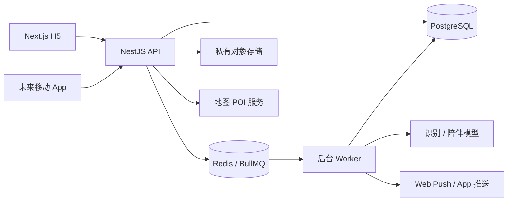
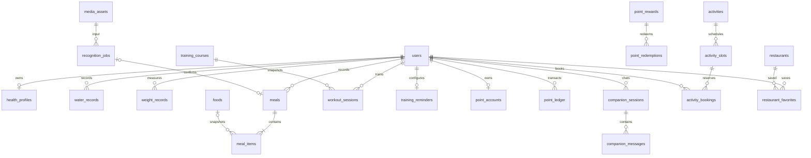

# 轻养健康 App：前端参数、接口、后端与数据库设计

版本：V1.0（后端待开发方案）  
日期：2026-10-18  
适用端：当前 H5，后续 iOS / Android App  
适用人员：前端、后端、测试、产品与运维

> 当前项目只有 Next.js 前端、本地状态及演示服务，尚无本文定义的业务 API、数据库、登录与推送。本文是基于现有页面整理的建议对接契约，不代表接口已经上线。新增账号、通知、运营能力用于支撑真实业务；用户端优先覆盖现有页面，不要求一次实现所有扩展功能。

## 目录

1. 当前前端与模块边界
2. 后端技术与部署方案
3. 全局接口与数据约定
4. 账号、用户与健康档案
5. 今日看板与可视化大屏
6. 饮食记录与拍照识别
7. 训练计划、监督与提醒
8. 附近餐饮推荐与收藏
9. 积分任务与兑换
10. 情绪记录与 AI 陪伴
11. 活动预约与社交
12. 公共上传、通知及基础设施表
13. 表关系、事务与关键约束
14. 前端改造与联调顺序
15. 验收标准与官方参考

## 1. 当前前端与模块边界

### 1.1 页面、数据与改造入口

| 模块 | 当前路由 | 当前实现文件 | 真实后端接入后 |
| --- | --- | --- | --- |
| 今日健康日记 | `/dashboard` | `src/features/dashboard/dashboard.tsx` | 按日期查询汇总，提交饮水、体重 |
| 可视化大屏 | `/overview` | `src/features/overview/overview.tsx` | 查询个人近 7 / 30 天指标、趋势与完整度 |
| 饮食与拍照识别 | `/nutrition` | `src/features/nutrition/nutrition.tsx` | 上传照片、异步识别、用户确认、饮食记录 |
| 训练与提醒 | `/training` | `src/features/training/training.tsx` | 课程、计划、训练会话、监督规则与提醒 |
| 餐饮推荐 | `/nutrition#nearby` | 同饮食模块 | 定位授权、真实 POI 查询、收藏 |
| 积分 | `/profile` | `src/features/profile/profile.tsx` | 服务端任务、账本、兑换订单 |
| 情绪与陪伴 | `/companion` | `src/features/companion/companion.tsx` | 情绪记录、会话、模型回复 |
| 预约社交 | `/profile#activities` | 同我的模块 | 活动、场次、名额、预约取消、参与者 |
| 健康档案 | 我的页面弹层 | 同我的模块 | 用户资料与健康目标 |

当前类型见 `src/lib/health/types.ts`；本地规则见 `reducer.ts`；示例内容见 `seed.ts`；模拟识别与聊天见 `services.ts`；持久化见 `src/components/health-provider.tsx`。

### 1.2 当前字段向接口映射

| 现有字段 | API 字段 | 说明 |
| --- | --- | --- |
| `dailyRecords[date].water` | `water.totalMl` | 当前为日累计；后端保存每次饮水事件再聚合 |
| `dailyRecords[date].weight` | `weight.latestKg` | 后端允许一天多次，页面显示当日最新值 |
| `meals[].meal` | `mealType` | 中文改为 `breakfast/lunch/dinner/snack`，展示时转中文 |
| `meals[].name/grams/calories` | `items[].name/grams/caloriesKcal` | 真实一餐可有多个食物，前端需从单食物升级为数组 |
| `completedWorkouts[]` | `workoutSessions[]` | 后端保存开始、暂停、完成等状态 |
| `moods[].value` | `mood` | `happy/calm/tired/low` |
| `messages[].text` | `content` | 按会话分页，并保留生成状态 |
| `favorites[]` | `restaurantId[]` | 收藏操作使用幂等 PUT/DELETE，不使用 toggle |
| `bookings[]` | `bookings[]` | 从活动 ID 升级为预约对象及具体场次 ID |
| `ledger[].points` | `delta` | 服务端有符号整数，前端不能自行决定奖励额度 |
| `reminder.time` | `localTime` | 与 `timezone` 一同保存 |
| `goal` | `targetWeightKg` | 健康目标还包含饮水、热量与营养目标 |

### 1.3 首版边界

- 大屏指个人健康数据可视化，不是所有用户健康信息的公开看板。运营统计必须另建管理员权限接口。
- 训练监督首版指计划、计时、打卡与提醒；摄像头动作纠正、教练视频连线不在首版。
- 预约社交首版指活动发现、场次预约、取消、公开参与者与举报/屏蔽；一对一匹配、私信、付费课程后续扩展。
- 暂不实现会员支付、真实商品物流、智能秤、手环、医疗诊断。真实积分兑换首版可仅接数字权益，未接履约前保持演示入口。
- 320 初始积分、连续 12 天、示例体重和示例商家是演示内容，不能在上线后当成真实历史或账户资产导入。

## 2. 后端技术与部署方案

### 2.1 建议技术组合

| 层次 | 建议技术 | 职责与选择理由 |
| --- | --- | --- |
| H5 | 保留 Next.js + React + TypeScript | 保留已有框架，改为请求 API |
| 业务 API | Node.js 当前受支持 LTS + NestJS + TypeScript | 按业务模块组织，H5 和未来 App 共用 REST API |
| 数据访问 | Prisma + 数据库迁移 | 常规 CRUD、事务、类型；必要的行锁与约束通过参数化 SQL / migration 实现 |
| 关系数据库 | PostgreSQL | 用户、健康记录、预约、积分等事务数据 |
| 队列与缓存 | Redis + BullMQ | 识别、消息生成、提醒、通知重试；余额与预约名额的最终真相仍在 PostgreSQL |
| 文件 | S3 兼容对象存储（可选云厂商 OSS/COS） | 私有图片、头像、课程封面；短时签名上传/读取 |
| AI | 独立 Provider Adapter | 图像识别、结构化营养结果、文本陪伴；不把供应商格式直接暴露给前端 |
| 地图 | 地图/POI Provider Adapter | 供应商按实际部署区域选择，统一坐标系再计算距离 |
| 通知 | Web Push + App 推送适配器 + 站内通知 | H5 与 App 能力不同，由统一通知服务路由 |
| 接口文档 | OpenAPI + Swagger UI | 本文先定义契约，开发时由 DTO 生成机器可读文档与客户端类型 |
| 部署 | Docker，反向代理 HTTPS | 前端、API、Worker 独立进程，数据库和 Redis 使用持久化托管实例或可靠存储 |
| 观测 | 结构化日志、错误追踪、指标与告警 | requestId 串联 API、任务、模型和通知投递 |

这是本项目的建议选型，不是已安装依赖清单。后端建项时锁定兼容版本，避免文档写死容易过期的版本号。首期一个模块化后端代码库即可，不必拆微服务。NestJS 官方提供 BullMQ 集成，BullMQ 以 Redis 保存队列任务，可用于 API 与 Worker 分离。[官方说明](https://docs.nestjs.com/techniques/queues)

### 2.2 服务结构



建议后端目录：`auth`、`users`、`health`、`nutrition`、`recognition`、`training`、`restaurants`、`points`、`companion`、`activities`、`uploads`、`notifications`、`admin`、`common`。数据库先共用一个实例，禁止各模块直接修改其他模块核心账务表。

### 2.3 环境与运维参数

| 参数 | 使用位置 | 含义 |
| --- | --- | --- |
| `DATABASE_URL` | API / Worker | PostgreSQL 连接，设置连接池上限 |
| `REDIS_URL` | API / Worker | 队列和缓存，生产使用认证与网络隔离 |
| `PUBLIC_WEB_ORIGIN`、`CORS_ALLOWED_ORIGINS` | API | H5 域名和允许来源，不可配通配符加凭证 |
| `SESSION_SIGNING_KEY`、`TOKEN_SIGNING_KEY` | API | 会话与短期访问凭据，定期轮换 |
| `OBJECT_STORAGE_ENDPOINT/BUCKET/ACCESS_KEY/SECRET_KEY` | 服务端 | 私有存储接入 |
| `AI_PROVIDER/AI_API_KEY/AI_BASE_URL` | Worker | 模型适配器配置，不能出现在 NEXT_PUBLIC 变量中 |
| `MAP_PROVIDER/MAP_API_KEY` | API | 商家搜索与坐标转换 |
| `SMS_PROVIDER/SMS_SECRET` | API | 账号验证码 |
| `WEB_PUSH_VAPID_PUBLIC_KEY/PRIVATE_KEY` | 通知服务 | 公钥可下发，私钥仅服务端 |
| `APP_PUSH_*` | 通知服务 | App 阶段再配置 |
| `DEFAULT_TIMEZONE=Asia/Shanghai` | 服务端 | 首版业务日边界 |

部署环境分 development / staging / production；数据库迁移先在 staging 验证。数据库备份与恢复演练、队列失败告警、对象存储清理任务随真实用户接入同步完成。

## 3. 全局接口与数据约定

### 3.1 地址、身份与字段

- 基础路径：`/api/v1`。下文所有路径均省略此前缀。
- 请求和响应字段使用 camelCase；数据库使用 snake_case。写请求拒绝未声明字段，防止 userId、role、余额和状态等被批量赋值。
- IDs 为 UUID 字符串。文档中 `<uuid>` 是占位符，联调请求须替换为真实 UUID。
- JSON 的体重、克数、热量等统一返回 number，由服务端显式转换数据库 numeric；积分为整数、价格为整数分，防止浮点金额误差。
- 时间戳使用带时区的 ISO 8601，如 `2026-10-18T11:00:00Z`；业务日期用 `YYYY-MM-DD`；数据库时间戳使用 `timestamptz`。
- 首版 `timezone` 固定为 `Asia/Shanghai`，客户端传其他值返回 422。为未来国际化保留字段，扩展前不允许随意切时区刷每日任务。
- `createdAt` 由服务端生成。记录可提交 `recordedAt`；时间范围为当前服务端时间之前 30 天至当前时间，不接受未来时间。首次超出范围历史导入另走受控入口。
- 日常奖励只对服务器当前业务日且满足任务条件的操作发放；补录过去记录不补发签到、饮水或饮食积分。
- 所有 `/me` 下资源由服务端从身份获取 userId；业务请求不接受客户端自填的所有者 ID。

### 3.2 登录态

H5 通过同站反向代理访问 `/api/v1`，使用 Secure、HttpOnly 的会话/刷新 Cookie；后续原生 App 使用 Bearer 短期 accessToken 和安全存储的 refreshToken。认证主体、业务接口、权限规则相同。

H5 非安全方法必须校验 Origin 和 CSRF：登录前验证码/登录校验允许来源；登录后通过 `GET /auth/csrf` 获取与会话绑定的 token，写请求携带 `X-CSRF-Token`。不要把长期刷新凭据存进 localStorage。App Bearer 请求无需 Cookie CSRF，但仍需鉴权、限流和资源归属检查。

### 3.3 通用请求头

| 名称 | 必填 | 用途 |
| --- | --- | --- |
| `Content-Type: application/json` | JSON 写入 | 文件直传、SSE 除外 |
| `Authorization: Bearer <accessToken>` | App | H5 使用 Cookie |
| `X-CSRF-Token` | H5 登录后的写请求 | 与会话绑定 |
| `Idempotency-Key` | 本文所有 POST 创建/命令接口 | UUID，网络重试复用原 key；新的用户操作生成新 key |
| `X-Client-Platform` | 是 | `h5/ios/android`，仅用于能力与日志，不作为可信身份 |
| `X-Request-Id` | 否 | 客户端追踪提示；服务端校验或重建后返回 requestId |

POST 幂等作用域为 `(用户或登录前挑战身份, method, path, key)`，保存 bodyHash、状态和响应至少 24 小时。同 key 同内容重放原结果；同 key 不同内容返回 `409 IDEMPOTENCY_CONFLICT`；正在执行返回 `409 REQUEST_IN_PROGRESS` 及建议重试秒数。业务唯一约束仍需独立存在，不能只依赖请求缓存。

### 3.4 成功、分页和错误

普通成功返回：

```json
{
  "data": {"id": "<uuid>"},
  "meta": {"requestId": "<uuid>", "serverTime": "2026-10-18T11:00:00Z", "timezone": "Asia/Shanghai"}
}
```

创建记录一般返回 201；异步任务返回 202；查询、更新、幂等操作返回 200；删除返回 204 且没有 JSON。本文示例聚焦 `data` 内字段；未特别说明的响应都套此 envelope。

列表 Query：`limit?: integer=20`，范围 1–100；`cursor?: string`。返回 `data:{items:[],nextCursor:null}`。游标由服务端编码过滤条件和 `(createdAt,id)`，排序必须稳定。附近推荐有单独说明。

错误返回：

```json
{
  "error": {"code": "VALIDATION_ERROR", "message": "请填写有效的体重", "fields": {"weightKg": "范围为 20–350 kg"}, "retryAfterSeconds": null},
  "meta": {"requestId": "<uuid>", "serverTime": "2026-10-18T11:00:00Z"}
}
```

| HTTP | code | 前端行为 |
| --- | --- | --- |
| 400 | `BAD_REQUEST` | 展示可理解的请求问题 |
| 401 | `UNAUTHENTICATED` | 尝试一次刷新；仍失败转登录，不无限重试 |
| 403 | `FORBIDDEN` / `CSRF_INVALID` | 拒绝操作，必要时刷新 CSRF |
| 404 | `NOT_FOUND` | 资源不存在或不属于用户时同样返回，不泄露他人资源 |
| 409 | `VERSION_CONFLICT` / `ALREADY_COMPLETED` / `ACTIVITY_FULL` / `BOOKING_CLOSED` / `INSUFFICIENT_POINTS` / `OUT_OF_STOCK` | 显示原因并刷新该资源 |
| 413 / 415 | `FILE_TOO_LARGE` / `UNSUPPORTED_MEDIA_TYPE` | 重新选择文件 |
| 422 | `VALIDATION_ERROR` / `IMAGE_DECODE_FAILED` | 字段定位或换图 |
| 429 | `RATE_LIMITED` | 按 Retry-After / retryAfterSeconds 重试 |
| 502 / 503 | `PROVIDER_UNAVAILABLE` / `SERVICE_UNAVAILABLE` | 不显示虚假的成功结果，允许稍后重试 |

### 3.5 单位、枚举和空值

| 数据 | 单位 / 枚举 |
| --- | --- |
| 体重 / 身高 | kg，最多 1 位小数 / cm，最多 1 位小数 |
| 饮水 | ml 整数 |
| 能量 / 营养素 | kcal / g，最多 1 位小数 |
| 训练时长 | durationSeconds 整数，展示时转分钟 |
| 距离 / 价格 | distanceMeters 整数 / priceCents 整数，currency=`CNY` |
| 餐次 | `breakfast/lunch/dinner/snack` |
| 情绪 | `happy/calm/tired/low`；可拓展但前端有未知值兜底 |
| 课程分类 | `stretch/strength/cardio` |
| 普通内容状态 | `draft/published/archived` |

无体重、未知营养值、未知评分用 `null`，不使用 0 冒充。没有发生的饮水、运动累计可为 0。`isDemo` 必须由服务端环境决定；真实接口无数据时返回空状态，不能自动回填本地示例。

## 4. 账号、用户与健康档案

当前无账号界面，以下是接入真实多用户服务时新增的必要基础能力。建议首版手机验证码登录，后续再扩展第三方授权。

### 4.1 前端参数与接口

| 方法与路径 | 请求参数 | 返回 data / 行为 |
| --- | --- | --- |
| `POST /auth/sms-codes` | Body：`phone:string` E.164；`purpose:'login'` | `{challengeId,expiresInSeconds:300,resendAfterSeconds:60}`；手机号/设备/IP 联合限流，不返回验证码 |
| `POST /auth/login` | `challengeId:uuid,code:string(6位),deviceId:uuid,platform` | `{user,sessionExpiresAt,accessToken?,refreshToken?,accessExpiresInSeconds?}`；H5 设置 Cookie、不返回 token；App 返回 token。验证码单次消费，可首次建账号 |
| `GET /auth/csrf` | 无；已登录 H5 | `{csrfToken}`，与当前会话绑定 |
| `POST /auth/refresh` | App：`refreshToken:string`；H5：Cookie | 轮换刷新凭据；App 返回新 token，H5 更新 Cookie；旧刷新凭据重放撤销该会话 |
| `POST /auth/logout` | 无 | 撤销当前会话，清 Cookie；204 |
| `GET /me` | 无 | `{id,nickname,avatarUrl,joinedAt,timezone,consecutiveCheckinDays}`；avatarUrl 可 null |
| `PATCH /me` | `nickname?:string(1–30),avatarAssetId?:uuid\|null` | 更新后用户；不接受 phone/userId/role |
| `GET /me/health-profile` | 无 | 下述 HealthProfile |
| `PUT /me/health-profile` | 下述可写健康档案字段 + `version:int` | 完整档案及递增 version；版本过期 409 |

HealthProfile 可写字段：`heightCm?:number|null(50–250)`、`birthYear?:int|null`（1900 至当前年）、`targetWeightKg:number(20–350)`、`waterTargetMl:int(500–6000)`、`calorieTargetKcal:number(800–5000)`、`carbsTargetG?:number|null`、`proteinTargetG?:number|null`、`fatTargetG?:number|null`（三者 0–1000）、`goalType:'balanced/maintain/lose/gain'`。目标为用户配置，不默认声称适合每个人；专业推荐策略后续另行评估。

返回还含 `userId,version,updatedAt`。身高不全时 BMI 返回 null，年龄信息不推导医疗结论。

### 4.2 表结构

字段简写：`U` 表示 unique，`?` 表示可空；无 `?` 的业务字段均 NOT NULL。除复合主键/特殊说明外，每表含 `id uuid PK DEFAULT gen_random_uuid()`、`created_at timestamptz DEFAULT now()`；可变表再含 `updated_at timestamptz DEFAULT now()`，应用或 trigger 更新。`user_id` 均 FK → `users.id`，业务外键默认 RESTRICT，删除策略见第 12 节。

| 表 | 字段（除公共列） | 约束 / 索引 |
| --- | --- | --- |
| `users` | `phone_ciphertext text`，`phone_lookup_hash char(64)`，`nickname varchar(30)`，`avatar_asset_id uuid? FK media_assets`，`timezone varchar(64) DEFAULT 'Asia/Shanghai'`，`status varchar(16) DEFAULT 'active'`，`deleted_at timestamptz?` | U(phone_lookup_hash)；status=`active/disabled/deleted`；phone 加密存储、按带密钥摘要查找 |
| `auth_challenges` | `phone_lookup_hash char(64)`，`purpose varchar(16)`，`code_hash text`，`expires_at timestamptz`，`consumed_at timestamptz?`，`attempts smallint DEFAULT 0` | code 不落明文；索引(phone_lookup_hash,created_at DESC)；attempts 0–5 |
| `user_sessions` | `user_id uuid`，`device_id uuid`，`platform varchar(16)`，`refresh_family_id uuid`，`expires_at timestamptz`，`revoked_at timestamptz?`，`last_seen_at timestamptz` | 索引(user_id,revoked_at)；刷新凭据单独存 refresh_tokens，旧摘要保留到 family 过期 |
| `refresh_tokens` | `session_id uuid FK user_sessions`，`token_hash char(64)`，`expires_at timestamptz`，`consumed_at timestamptz?`，`replaced_by uuid? FK refresh_tokens` | U(token_hash)；索引(session_id,expires_at)；刷新时锁定当前 token，单次消费并创建下一枚，旧 token 重放撤销整个会话 |
| `health_profiles` | `user_id uuid U`，`height_cm numeric(4,1)?`，`birth_year smallint?`，`target_weight_kg numeric(4,1)`，`water_target_ml int`，`calorie_target_kcal numeric(6,1)`，`carbs_target_g numeric(5,1)?`，`protein_target_g numeric(5,1)?`，`fat_target_g numeric(5,1)?`，`goal_type varchar(16)`，`version int DEFAULT 1` | CHECK 与 API 范围一致；不保存重复的当前体重，当前体重来自测量表 |

验证码保留短时效并定期清理；失效会话不可继续访问业务数据。所有私有接口必须执行归属校验。

## 5. 今日看板与可视化大屏

### 5.1 接口

| 方法与路径 | 参数 | 返回 |
| --- | --- | --- |
| `GET /me/dashboard` | Query：`date?:date`，默认当前业务日；`timezone?:'Asia/Shanghai'` | Dashboard，下方示例 |
| `GET /me/health/overview` | Query：`range?:7或30=7`，`endDate?:date=今天` | Overview，包含全部日期的数据点和完整度 |
| `POST /me/water-records` | Body：`amountMl:int(1–1000),recordedAt?:ISO,source?:'manual'=manual` | `{record,todaySummary,awards:[]}`；日累计上限 6000 ml 为录入边界，不是健康建议 |
| `GET /me/water-records` | Query：`date:date` + 分页 | 单次饮水记录列表 |
| `DELETE /me/water-records/{id}` | Path：uuid | 204；只允许删除本人记录，重算汇总，不因此允许重新刷同日奖励 |
| `POST /me/weight-records` | `weightKg:number(20–350),recordedAt?:ISO,source?:'manual'` | `{id,weightKg,recordedAt,businessDate}` |
| `GET /me/weight-records` | `startDate,endDate`（含端点，最多 366 天）+ 分页 | 测量记录列表 |
| `DELETE /me/weight-records/{id}` | uuid | 204；当日显示剩余记录中的最新值 |

历史补录时前端把选择的业务日期转换为明确的 recordedAt（例如上海当日 12:00），不可只传无时区的时间字符串。今天的饮水按钮默认 amountMl=250。

### 5.2 Dashboard 响应参数

```json
{
  "date": "2026-10-18",
  "isDemo": false,
  "water": {"totalMl": 1250, "targetMl": 2000, "progress": 0.625},
  "weight": {"latestKg": 58.6, "targetKg": 55, "previousKg": 58.8, "changeKg": -0.2, "bmi": null},
  "energy": {"intakeKcal": 805, "exerciseKcal": 65, "baseTargetKcal": 1800, "effectiveTargetKcal": 1865, "remainingKcal": 1060},
  "nutrients": {
    "carbs": {"consumedG": 97, "targetG": 225, "complete": true},
    "protein": {"consumedG": 52, "targetG": 90, "complete": true},
    "fat": {"consumedG": 20, "targetG": 60, "complete": true}
  },
  "week": [{"date": "2026-10-18", "hasMealRecord": true, "hasTrainingRecord": true}],
  "latestMeal": null,
  "recommendedWorkout": null,
  "pointsBalance": 35,
  "dailyTasks": [],
  "generatedAt": "2026-10-18T11:00:00Z"
}
```

`week` 实际固定返回截至查询日的连续 7 天。latestMeal 使用第 6 节 Meal DTO；recommendedWorkout 使用第 7 节 Course DTO；dailyTasks 使用第 9 节 Task DTO。示例为空表示可空，不代表这些字段固定为空。

### 5.3 聚合口径

- `effectiveTargetKcal = baseTargetKcal + 当日已完成训练估算消耗`，与现有 UI 保持一致；这是产品预算算法，需明确展示估算，不是医疗处方。
- `remainingKcal = max(effectiveTargetKcal - intakeKcal,0)`；可另外返回 `exceededKcal` 显示超出值。
- 营养摄入从食物项快照相加；任何一项缺失则该营养素 `consumedG` 可为已知部分合计，但 `complete=false`，前端显示“部分估算”。不得继续按总热量固定比例伪造营养素。
- `weight.latestKg` 为查询日最新测量；无当日测量则 null。previousKg 是查询日之前最近测量；最新全局体重供档案单独使用。`changeKg` 任一缺失则 null。
- Overview 返回 `range,startDate,endDate,generatedAt,summary,series,coverage`；series 每天包含 `date,intakeKcal,exerciseKcal,waterMl,weightKg,mood,completedWorkouts,hasMealRecord,hasWaterRecord`，缺测体重/情绪 null。
- `summary.avgIntakeKcal` 分母是有饮食记录的天数；`avgWaterMl` 分母是有饮水记录的天数。没有记录则 null。不能以“有体重但无饮水”的日期稀释饮水均值。
- `summary` 还含 `completedWorkouts,totalExerciseKcal,latestWeightKg,moodRecordedDays,pointsBalance,activeBookings`。coverage 返回 `mealDays,waterDays,weightDays,moodDays,rangeDays`，图表明确记录完整度。
- 前端写入成功后刷新 dashboard / overview 及受影响积分任务；不可只更新一个页面而让大屏仍显示旧缓存。

### 5.4 表结构

| 表 | 字段 | 约束 / 索引 |
| --- | --- | --- |
| `water_records` | `user_id uuid`，`amount_ml int`，`recorded_at timestamptz`，`business_date date`，`timezone varchar(64)`，`source varchar(16)` | CHECK amount 1–1000；索引(user_id,business_date,recorded_at DESC,id)；日上限由事务内校验 |
| `weight_records` | `user_id uuid`，`weight_kg numeric(4,1)`，`recorded_at timestamptz`，`business_date date`，`timezone varchar(64)`，`source varchar(16)` | CHECK 20–350；索引(user_id,business_date,recorded_at DESC,id) |

看板初期直接按 user_id 与 business_date 聚合，不必另建数据仓库。目标值首版按当前档案返回，查询历史日期也标注为“当前目标”，不声称为该日历史目标；需要历史目标回放时应增加 profile_goal_versions。若数据量扩大，再增加可重建的 daily_health_stats 物化投影；该投影不是原始事实表，不能用它发积分。

## 6. 饮食记录与拍照识别

### 6.1 前端数据对象

Meal DTO：`id,mealType,recordedAt,businessDate,source,photoAssetId?,photoUrl?,items[],totals,version,createdAt,updatedAt`。

FoodItem DTO：`id,foodId?:uuid|null,name:string,grams:number,caloriesKcal:number,carbsG:number|null,proteinG:number|null,fatG:number|null,nutritionSource:'catalog/model/user',confidence:number|null`。name 1–100 字；grams 与 caloriesKcal 大于 0 且不超过 5000；营养素 0–1000，未知为 null。一餐 items 为 1–30 项；总计由服务端计算，不接受前端自填 totals。

`source=manual/photo`；模型置信度不代表营养测量精度。编辑食物名、份量或热量后，该字段来源记为 user；目录食物以食物库每 100g 营养值按份量计算，保存记录时保留营养快照，后续改食物库不能改变历史摄入。

### 6.2 接口契约

| 方法与路径 | 请求参数 | 返回 / 说明 |
| --- | --- | --- |
| `GET /foods` | Query：`keyword?:string(1–50)` + 分页 | 食物库 `{id,name,unit:'100g',caloriesKcal,carbsG,proteinG,fatG}` |
| `GET /me/meals` | Query：`date:date,mealType?:枚举` + 分页 | Meal 列表，按 recordedAt DESC,id DESC |
| `GET /me/meals/{id}` | uuid | 完整 Meal |
| `POST /me/meals` | Body：`mealType,recordedAt?,source,photoAssetId?:uuid,recognitionJobId?:uuid,items[]` | `{meal,awards:[]}`；201；manual 可以不传图片与任务 |
| `PATCH /me/meals/{id}` | `version:int,mealType?,recordedAt?,items?:完整数组` | 更新后的 Meal；数组整体替换，避免单项并发丢失；不重复发奖励 |
| `DELETE /me/meals/{id}` | uuid | 204；删除后重算统计，不重置奖励资格 |
| `POST /me/recognition-jobs` | `assetId:uuid,mealType?:枚举` | 202，`{id,status:'queued',pollAfterMs:1500}`；仅接受本人 ready 图片 |
| `GET /me/recognition-jobs/{id}` | uuid | `{id,status,items:FoodItemDraft[],error:null或{code,message},createdAt,completedAt?}` |
| `POST /me/recognition-jobs/{id}/cancel` | 无 Body | `{id,status}`；queued/running 可转 canceled；已结束返回当前状态 |

识别状态：`queued → running → succeeded/failed`，未结束可取消；终态不再改变。`items` 仅 succeeded 有值。单任务建议 45 秒超时；前端从 1.5 秒轮询，退避至 5 秒，最长前台等候 60 秒后允许稍后回查，不能自动重复创建收费任务。

`recognitionJobId` 若提交，必须属于本人、状态 succeeded、且 assetId 与 photoAssetId 一致；任务与最终 meal 建立一对一关联，同任务重复确认返回已有 meal，不能生成多条摄入记录；若原 meal 已被删除，返回 409 `RECOGNITION_ALREADY_USED`，不能借重用任务重新发奖。取消/失败任务不能确认。识别结果允许用户修改后保存，不强制与模型建议完全一致。

### 6.3 拍照完整流程

1. 前端本地验证文件大小和可解码性，调用第 12 节上传接口获取签名。
2. 直传到私有对象存储，提交上传完成；服务端校验真实媒体类型、体积和解码结果，状态 ready 后才可识别。HEIC 仅在后端具备转换能力时开放，客户端不支持预览则先提示换图。
3. 创建识别任务；Worker 读取私有文件，调用视觉模型，校验结构化结果。输出不合法或无法确定食物则 failed/低置信候选，不编造成功。
4. 前端展示候选食物、份量、估算热量和营养值，允许修改、删除及新增候选。
5. 用户点“确认记录”才 POST meals；识别成功本身不计入饮食日记，不发饮食积分。
6. 保存成功后刷新该日饮食列表、看板、大屏、积分任务；关闭弹层不等于保存。离开页面可取消轮询，是否取消任务由用户操作决定。

请求示例（data 前的请求 Body）：

```json
{
  "mealType": "lunch",
  "recordedAt": "2026-10-18T04:10:00Z",
  "source": "photo",
  "photoAssetId": "<uuid>",
  "recognitionJobId": "<uuid>",
  "items": [{"foodId": null, "name": "鸡胸肉蔬菜沙拉", "grams": 350, "caloriesKcal": 425, "carbsG": 30, "proteinG": 35, "fatG": 15, "nutritionSource": "user"}]
}
```

客户端不能提交 confidence、模型名称、供应商账单或任务状态；这些由服务端记录。catalog 来源的营养值服务端重算，user 来源值仍须校验。

### 6.4 表结构

| 表 | 字段 | 约束 / 索引 |
| --- | --- | --- |
| `foods` | `name varchar(100)`，`calories_per_100g numeric(6,1)`，`carbs_per_100g numeric(5,1)?`，`protein_per_100g numeric(5,1)?`，`fat_per_100g numeric(5,1)?`，`source varchar(32)`，`status varchar(16)` | 数值非负；索引(status,name)；食物全文/模糊搜索按实际需求加专用索引 |
| `recognition_jobs` | `user_id uuid`，`asset_id uuid FK media_assets`，`status varchar(16)`，`result jsonb?`，`provider varchar(40)?`，`model varchar(80)?`，`error_code varchar(64)?`，`started_at timestamptz?`，`completed_at timestamptz?` | status 枚举同接口；索引(user_id,created_at DESC,id)；result 为经校验的候选结果，不是直接透传供应商响应 |
| `meals` | `user_id uuid`，`meal_type varchar(16)`，`recorded_at timestamptz`，`business_date date`，`timezone varchar(64)`，`source varchar(16)`，`photo_asset_id uuid? FK media_assets`，`recognition_job_id uuid? FK recognition_jobs`，`version int DEFAULT 1`，`deleted_at timestamptz?` | U(recognition_job_id)，PostgreSQL 允许多条 null；索引(user_id,business_date,recorded_at DESC,id) WHERE deleted_at IS NULL |
| `meal_items` | `meal_id uuid FK meals`，`food_id uuid? FK foods`，`name varchar(100)`，`grams numeric(7,1)`，`calories_kcal numeric(7,1)`，`carbs_g numeric(5,1)?`，`protein_g numeric(5,1)?`，`fat_g numeric(5,1)?`，`nutrition_source varchar(16)`，`confidence numeric(4,3)?`，`sort_order smallint` | confidence 0–1；U(meal_id,sort_order)；索引(meal_id)；食物字段为历史快照 |

Meal 及所有 items 在同一事务写入；meals 不必重复保存 totals，接口聚合 items 得出，避免数据漂移。

## 7. 训练计划、监督与提醒

### 7.1 前端参数

Course DTO：`id,title,category,level,description,coverUrl,estimatedDurationSeconds,estimatedCaloriesKcal,status,version`。真实课程可追加 `videoUrl?`，只有资源已授权且可播放才返回；首版不要求视频。

WorkoutSession DTO：`id,courseId,status,startedAt,endedAt?,activeDurationSeconds,estimatedCaloriesKcal,businessDate,version`。状态 `active/paused/completed/abandoned`；消耗是基于课程与有效时长的估算，不接收前端任填 kcal。

Plan DTO：`id,title,startDate,endDate,status,days[]`；days 项为 `{date,restDay,courses:[Course DTO]}`。首版可由固定模板生成，AI 自动定制以后增加。

### 7.2 接口

| 方法与路径 | 请求参数 | 返回 / 行为 |
| --- | --- | --- |
| `GET /training/courses` | Query：`category?:stretch/strength/cardio,level?:beginner/intermediate,keyword?:string` + 分页 | Course 列表，只返回 published |
| `GET /training/courses/{id}` | uuid | Course 详情 |
| `GET /me/training-plan` | `weekStart:date`，上海周一 | Plan；没有计划返回 `{plan:null}`，不伪装真实已定制 |
| `POST /me/training-plans` | `templateId:uuid,startDate:date` | 201，Plan；只允许一个 active 计划，旧计划转 archived |
| `GET /training/plan-templates` | 分页 | `{id,title,description,days:[{dayOffset,restDay,courseIds}]}` |
| `POST /me/workout-sessions` | `courseId:uuid` | 201，active Session；开始时绑定课程估算快照与服务器时间 |
| `PATCH /me/workout-sessions/{id}` | `action:'pause/resume/abandon',version:int` | 新 Session；非法状态转移返回 409 |
| `POST /me/workout-sessions/{id}/complete` | `version:int` | `{session,awards:[]}`；重复完成返回已完成结果，不再发奖 |
| `GET /me/workout-sessions` | `startDate,endDate`，最多 366 天；`status?` + 分页 | Session 列表 |
| `GET /me/training-reminder` | 无 | Reminder DTO |
| `PUT /me/training-reminder` | 下述 Reminder 可写字段 + version | 保存后 Reminder |

Reminder：`enabled:boolean,localTime:'HH:mm',timezone:'Asia/Shanghai',weekdays:int[](1=周一…7=周日),channels:('in_app'/'web_push'/'app_push')[],skipIfCompleted:boolean,version:int`。weekdays 去重且 1–7；enabled=true 时非空。返回额外 `id,nextTriggerAt,deliveryCapability:{webPush:boolean,appPush:boolean}`；用户选择不支持通道时返回 422 与可用通道，不能显示已经成功开启推送。

### 7.3 状态、监督和通知规则

- 开始训练时立即创建 session；暂停/继续以服务端时间累积有效时长，前端计时只负责展示。断网时显示“未同步”，不能认为服务端已完成。
- 同一用户最多一个 active/paused session；用户开始新课时须先结束或放弃旧会话，冲突返回已有 sessionId。
- 完成时锁定会话，计算 activeDurationSeconds，关闭最后一段活动区间，写完成状态与奖励事件。轻触“完成”不能直接领取完整课程消耗。
- 建议首版有效完成门槛为 `min(课程预计时长×80%,课程预计时长)`，且最多按课程预计时长计估算消耗；低于门槛允许保存 completed 训练记录，但 `rewardEligible=false`、不发积分。此规则是上线建议，相比当前演示的随时打卡更严格，前端需展示门槛与进度。
- 完成日按 endedAt 的上海日期归属；跨午夜训练不拆分到两天，未来若做运动科学统计可增加分段分摊。
- 提醒 Worker 每分钟扫描 next_trigger_at；是否已完成按服务端当天训练记录判定。skipIfCompleted=true 且当天已有有效完成训练则跳过该次提醒。
- 更新/关闭提醒要使旧调度失效；任务执行前重新查询 version、enabled 与 nextTriggerAt，不能只删除 Redis 任务后假设必然停止。
- 推送可失败或被系统限制，API 的“设置成功”不等于“通知必达”。H5 Web Push 需 Service Worker、授权和浏览器支持；Apple 文档说明 iOS 的 Web Push 适用于受支持的主屏幕 Web App，不能承诺普通 H5 标签页都可后台推送。[Apple 官方文档](https://developer.apple.com/documentation/usernotifications/sending-web-push-notifications-in-web-apps-and-browsers)

### 7.4 表结构

| 表 | 字段 | 约束 / 索引 |
| --- | --- | --- |
| `training_courses` | `title varchar(100)`，`category varchar(16)`，`level varchar(16)`，`description text`，`cover_asset_id uuid? FK media_assets`，`video_asset_id uuid? FK media_assets`，`estimated_duration_seconds int`，`estimated_calories_kcal numeric(7,1)`，`status varchar(16)`，`version int DEFAULT 1` | 时长 60–14400 秒、消耗非负；索引(status,category,level,id) |
| `training_plan_templates` | `title varchar(100)`，`description text`，`status varchar(16)` | published 才可选 |
| `training_template_items` | `template_id uuid FK training_plan_templates`，`day_offset smallint`，`course_id uuid? FK training_courses`，`rest_day boolean`，`sort_order smallint` | day_offset 0–27；rest_day=true 时 course_id=null；U(template_id,day_offset,sort_order) |
| `training_plans` | `user_id uuid`，`template_id uuid? FK training_plan_templates`，`title varchar(100)`，`start_date date`，`end_date date`，`status varchar(16)` | CHECK end_date>=start_date；每用户最多一个 active（部分唯一索引） |
| `training_plan_items` | `plan_id uuid FK training_plans`，`scheduled_date date`，`course_id uuid? FK training_courses`，`rest_day boolean`，`sort_order smallint` | U(plan_id,scheduled_date,sort_order)；模板生成后独立保存，不受模板后续编辑影响 |
| `workout_sessions` | `user_id uuid`，`course_id uuid FK training_courses`，`status varchar(16)`，`started_at timestamptz`，`active_since timestamptz?`，`accumulated_seconds int DEFAULT 0`，`ended_at timestamptz?`，`business_date date?`，`duration_snapshot_seconds int`，`calories_snapshot_kcal numeric(7,1)`，`active_duration_seconds int DEFAULT 0`，`estimated_calories_kcal numeric(7,1) DEFAULT 0`，`reward_eligible boolean DEFAULT false`，`version int DEFAULT 1` | 部分 U(user_id) WHERE status IN ('active','paused')；索引(user_id,business_date,status)；完成后时间和消耗不可任意修改 |
| `training_reminders` | `user_id uuid U`，`enabled boolean`，`local_time time`，`timezone varchar(64)`，`weekdays smallint[]`，`channels text[]`，`skip_if_completed boolean`，`next_trigger_at timestamptz?`，`version int DEFAULT 1` | 索引(next_trigger_at) WHERE enabled；星期、通道需数组内容 CHECK |

## 8. 附近餐饮推荐与收藏

### 8.1 定位与返回字段

前端只在用户点击附近推荐时请求定位；拒绝授权可手选城市与地图中心，或展示明确标记的推荐城市，不得伪装成用户附近。精确坐标默认不写入用户档案、访问日志或长期行为数据。

首版 API 坐标契约统一 `coordinateSystem='wgs84'`；地图适配器负责将供应商坐标转换到统一坐标系。返回经纬度附坐标系，地图展示再按 SDK 要求转换，禁止把 GCJ-02、BD-09 与 WGS84 混算距离。

Restaurant DTO：`id,provider,providerPlaceId,name,address,latitude,longitude,coordinateSystem,distanceMeters,rating:null或number,ratingScaleMax:null或number,priceCents:null或int,currency:'CNY',tags:string[],coverUrl?,nutritionVerified:boolean,estimatedCaloriesKcal:number|null,isFavorited:boolean,sourceUpdatedAt`。

没有菜单或营养数据时 calories=null；不能仅凭“轻食”标签猜出精确热量。评分必须同时给出原始评分上限和供应商来源。

### 8.2 接口

| 方法与路径 | 参数 | 返回 / 行为 |
| --- | --- | --- |
| `GET /restaurants/nearby` | Query：`latitude:number(-90…90),longitude:number(-180…180),coordinateSystem:'wgs84',radiusMeters?:int(100–5000)=2000,tag?:string,limit?:int(1–50)=20,cursor?:string` | `{items:Restaurant[],nextCursor,searchCenter,provider,generatedAt}`；游标绑定本次中心、半径、筛选，不允许换条件续页 |
| `GET /restaurants/{id}` | uuid；可选 query latitude/longitude 成对传 | Restaurant 及 `openingHours?:string,menuItems?:[]`；没传位置时 distanceMeters=null |
| `GET /me/restaurant-favorites` | 分页 | 收藏的 Restaurant 列表；已下架项返回 unavailable 状态 |
| `PUT /me/restaurant-favorites/{restaurantId}` | 无 Body | `{restaurantId,isFavorited:true}`；重复请求不重复插入 |
| `DELETE /me/restaurant-favorites/{restaurantId}` | uuid | 204；未收藏也返回 204 |

推荐首期基于距离、标签和可用数据排序；不引入复杂画像或医疗饮食推荐。服务端按供应商条款设置可缓存字段与 TTL，坐标按粗网格短期缓存搜索，不缓存带用户收藏态的整份公共结果。

### 8.3 表结构

| 表 | 字段 | 约束 / 索引 |
| --- | --- | --- |
| `restaurants` | `provider varchar(32)`，`provider_place_id varchar(128)`，`name varchar(150)`，`address text`，`latitude numeric(9,6)`，`longitude numeric(9,6)`，`coordinate_system varchar(16)`，`rating numeric(4,2)?`，`rating_scale_max numeric(4,2)?`，`price_cents int?`，`currency char(3) DEFAULT 'CNY'`，`tags text[]`，`cover_url text?`，`nutrition_verified boolean DEFAULT false`，`estimated_calories_kcal numeric(7,1)?`，`status varchar(16)`，`source_updated_at timestamptz`，`cache_expires_at timestamptz?` | U(provider,provider_place_id)；经纬度 CHECK；索引(status)；仅存供应商允许落库的数据，不能擅自持久化受限字段 |
| `restaurant_favorites` | `user_id uuid`，`restaurant_id uuid FK restaurants` | U(user_id,restaurant_id)；索引(user_id,created_at DESC,id) |

首期附近搜索交给地图供应商，不为小规模 POI 自建地理检索。后续做自营商家库可增加 PostGIS geography(Point,4326)+GiST，先评估地图协议与业务量。

## 9. 积分任务与兑换

### 9.1 前端展示与业务规则

- Task DTO：`code,title,description,rewardPoints,progress,target,status:'pending/completed',completedAt?,action:{type:'navigate/checkin',path?}`。
- Account DTO：`balance:int,lifetimeEarned:int,lifetimeSpent:int,version:int`；balance 只能使用服务端返回值，不能把本地账本加总后当成真实余额。lifetimeEarned 为全部正向流水合计，lifetimeSpent 为全部负向流水绝对值合计；退款也记入正向合计，若需要真实消费额应另按业务类型统计。
- Ledger DTO：`id,delta,balanceAfter,reason,businessDate,businessType,businessId,createdAt`；delta 为带正负号整数，流水不可直接编辑。
- 首版建议沿用演示规则：签到 10 分/日、首次有效饮食确认 10 分/日、首次有效饮水记录 5 分/日、同一课程有效训练 20 分/课程/日。课程不同可分别奖励，与当前 reducer 一致；页面“完成一次训练”任务完成后仍可训练其他课程。若运营改成全日只奖励一次，必须同时改唯一键作用域与前端文案。课程任务按服务端规则生成 scopeKey，不能由客户端任填。
- 初始化真实账户 balance=0。320 分为演示数据；真实新人奖励若要上线，须独立配置规则、独立 eventKey，只发一次。
- 删记录、取消收藏、重新打卡不清除已经完成的奖励幂等记录，避免反复领取。异常奖励由审计后的补偿负向流水处理，不直接删原账。

### 9.2 接口

| 方法与路径 | 请求参数 | 返回 / 行为 |
| --- | --- | --- |
| `GET /me/points/account` | 无 | Account |
| `GET /me/points/tasks` | `date?:date=今天` | `{date,items:Task[]}`；历史只读 |
| `POST /me/points/check-in` | 无 Body，业务日由服务端取当前日 | `{businessDate,alreadyCompleted,awards:[],account}`；重复签到返回 200、alreadyCompleted=true |
| `GET /me/points/ledger` | `startDate?,endDate?` + 分页 | Ledger 列表，createdAt DESC,id DESC |
| `GET /points/rewards` | 分页 | `{id,title,description,imageUrl?,costPoints,stock,status,dailyLimit,fulfillmentType,version}`；仅 published |
| `POST /me/points/redemptions` | `rewardId:uuid,quantity:int=1,expectedRewardVersion:int`，首版数量仅支持 1 | 201，`{id,status,costPoints,rewardTitle,createdAt,account}`；价格、库存、余额均服务端校验 |
| `GET /me/points/redemptions` | 分页 | 兑换订单；含 status、fulfillmentStatus、code? |

客户端不能向奖励接口提交 `delta/costPoints/userId/balance`。兑换的价格快照来自服务端商品表，前端显示价格可能已过期，变化时返回 `409 REWARD_CHANGED` 并要求重新确认。

Redemption 状态：`pending/fulfilled/failed/refunded`。扣分与预占库存成功后创建 pending；履约成功为 fulfilled；可恢复错误保持 pending 并重试；确定不可履约转 failed，再原子补偿到账并转 refunded。对外只展示最终明确状态，不允许用户伪造履约回调。

### 9.3 表结构

| 表 | 字段 | 约束 / 索引 |
| --- | --- | --- |
| `point_accounts` | `user_id uuid U`，`balance int DEFAULT 0`，`lifetime_earned int DEFAULT 0`，`lifetime_spent int DEFAULT 0`，`version int DEFAULT 1` | CHECK balance>=0；余额与账本同事务更新；取消/退款通过补偿流水 |
| `point_task_definitions` | `code varchar(40) U`，`title varchar(80)`，`description text`，`reward_points int`，`scope varchar(24)`，`active boolean`，`rule_version int` | reward_points>0；scope=`daily/daily_course/once`；code 不随标题变更 |
| `point_task_awards` | `user_id uuid`，`task_code varchar(40) FK point_task_definitions.code`，`business_date date`，`scope_key varchar(128) DEFAULT ''`，`rule_version int`，`points int`，`source_type varchar(32)`，`source_id uuid?` | U(user_id,task_code,business_date,scope_key)；daily 的 scope_key=''；daily_course 为 courseId；once 使用固定 business_date='1970-01-01'，避免跨天重复 |
| `point_ledger` | `user_id uuid`，`delta int`，`balance_after int`，`reason varchar(160)`，`business_date date`，`business_type varchar(32)`，`business_id uuid`，`event_key varchar(200)`，`reversal_of uuid? FK point_ledger` | U(user_id,event_key)；CHECK delta<>0、balance_after>=0；U(reversal_of) 防重复退款；索引(user_id,created_at DESC,id)；无 updated_at，禁止修改/删除 |
| `point_rewards` | `title varchar(100)`，`description text`，`image_asset_id uuid? FK media_assets`，`cost_points int`，`stock int`，`daily_limit int DEFAULT 1`，`fulfillment_type varchar(24)`，`status varchar(16)`，`version int DEFAULT 1` | cost_points>0、stock>=0；fulfillment_type 首版=digital；索引(status,id) |
| `point_redemptions` | `user_id uuid`，`reward_id uuid FK point_rewards`，`reward_title_snapshot varchar(100)`，`cost_points int`，`business_date date`，`status varchar(16)`，`fulfillment_status varchar(16)`，`fulfilled_at timestamptz?`，`redeem_code_ciphertext text?` | 索引(user_id,created_at DESC,id) 和(user_id,reward_id,business_date)；订单状态转移及退款需审计 |

任务奖励、账本、余额必须在同一数据库事务内。兑换先锁账户与奖励库存，再按服务端价格扣分、减库存、建订单、写账本及 outbox；不允许先扣分再异步“尽力建单”。PostgreSQL 行锁可以保护并发修改，ORM 事务用于把多次写入组成一个提交单元。[PostgreSQL 官方说明](https://www.postgresql.org/docs/current/explicit-locking.html)、[Prisma 事务说明](https://www.prisma.io/docs/orm/fundamentals/transactions)

## 10. 情绪记录与 AI 陪伴

### 10.1 情绪记录接口

| 方法与路径 | 请求参数 | 返回 |
| --- | --- | --- |
| `PUT /me/moods/{date}` | Path：date；Body：`mood:happy/calm/tired/low,note?:string(0–500)` | `{id,date,mood,note,updatedAt}`；同日覆盖，与当前 UI 一致；只允许过去 30 天至今天 |
| `GET /me/moods` | Query：`startDate,endDate`，最多 366 天 + 分页 | 情绪日记列表 |
| `DELETE /me/moods/{date}` | date | 204；本人可删除 |

情绪必须由用户主动选择，不把聊天推断当作用户自报的事实覆盖。note 及聊天默认私有，不出现在活动参与者资料和公开大屏。

### 10.2 会话与消息接口

Session DTO：`id,title,status,createdAt,updatedAt,lastMessageAt?`。
Message DTO：`id,sessionId,role:'user/assistant',content,status:'queued/generating/completed/failed/canceled',replyToId?,errorCode?,createdAt,completedAt?`。仅服务端能写 assistant 角色；前端不能上传 system prompt。

| 方法与路径 | 请求参数 | 返回 / 行为 |
| --- | --- | --- |
| `POST /me/companion/sessions` | `title?:string(1–60)` | 201，Session；默认“与小养聊聊” |
| `GET /me/companion/sessions` | 分页 | 本人的会话列表 |
| `GET /me/companion/sessions/{id}/messages` | uuid + 分页 | Message 列表；API 按 createdAt DESC,id DESC，UI 反转后展示时间正序 |
| `POST /me/companion/sessions/{id}/messages` | `content:string(1–2000),clientMessageId:uuid` | 202，`{userMessage,assistantMessage,streamUrl}`；持久化用户消息与 queued 回复后再调模型 |
| `GET /me/companion/messages/{id}` | assistant 消息 uuid | Message；轮询或断线恢复时使用 |
| `GET /me/companion/messages/{id}/events` | `afterSequence?:int>=0`；可结合 Last-Event-ID | SSE；只允许本人消息；见下方事件格式 |
| `POST /me/companion/messages/{id}/cancel` | uuid，无 Body | Message；取消 queued/generating 回复，部分内容标记 canceled，不假装完整 |
| `DELETE /me/companion/sessions/{id}` | uuid | 204；会话与消息按删除策略处理，同时取消未完成生成 |

同会话最多一个 queued/generating 回复；仍在生成时再次发送返回 `409 GENERATION_IN_PROGRESS`。同 userId+clientMessageId 只能产生一条用户消息及一条对应回复，重试不重复调用模型。首版失败后可显示失败并允许重新发送新消息，不定义自动重试收费模型的无限循环。

### 10.3 流式响应约定

采用“POST 创建消息 + GET 订阅 SSE”，避免把需要写请求参数的创建过程塞进 EventSource。H5 使用同站 Cookie；原生 App 以支持自定义 Authorization 的 HTTP 流客户端订阅。不要把 accessToken 放入 streamUrl query。

SSE 不套普通 JSON envelope：

```text
id: 1
event: message.delta
data: {"messageId":"<uuid>","sequence":1,"delta":"允许自己"}

id: 2
event: message.delta
data: {"messageId":"<uuid>","sequence":2,"delta":"慢下来。"}

id: 3
event: message.completed
data: {"messageId":"<uuid>","sequence":3,"status":"completed","content":"允许自己慢下来。"}
```

失败为 `message.failed`，data 含 messageId、sequence、errorCode、可展示 message；取消为 `message.canceled`。15 秒心跳用 SSE comment。事件可在 Redis 保留 10 分钟；断线按 sequence 去重续传，若历史已过期则返回 410 `STREAM_EXPIRED`，前端 GET 消息最终状态，不重复发 POST。数据库保存已生成的内容快照及最终状态，Redis 不是聊天历史唯一存储。

模型 Worker 需处理超时、取消、内容校验、配额和服务异常；不可执行模型文本中要求的任意数据库写入。聊天中“帮我记一餐”首版只导航/生成待确认草稿，真实写健康记录仍需前端明确确认。

### 10.4 表结构

| 表 | 字段 | 约束 / 索引 |
| --- | --- | --- |
| `mood_records` | `user_id uuid`，`business_date date`，`mood varchar(16)`，`note varchar(500)?` | U(user_id,business_date)；mood CHECK；索引(user_id,business_date DESC) |
| `companion_sessions` | `user_id uuid`，`title varchar(60)`，`status varchar(16)`，`last_message_at timestamptz?`，`deleted_at timestamptz?` | status=active/archived；索引(user_id,last_message_at DESC,id) WHERE deleted_at IS NULL |
| `companion_messages` | `session_id uuid FK companion_sessions`，`user_id uuid`，`role varchar(16)`，`content text`，`status varchar(16)`，`client_message_id uuid?`，`reply_to_id uuid? FK companion_messages`，`provider varchar(40)?`，`model varchar(80)?`，`error_code varchar(64)?`，`completed_at timestamptz?` | 部分 U(user_id,client_message_id) WHERE role='user'；部分 U(reply_to_id) WHERE role='assistant'；部分 U(session_id) WHERE role='assistant' AND status IN ('queued','generating')；索引(session_id,created_at DESC,id) |

会话 ID 与消息 user_id 必须属于同一个用户，服务端校验并可增加复合外键约束。健康和情绪相关聊天不用于公开画像；原始供应商响应不直接写常规日志。

## 11. 活动预约与社交

### 11.1 活动、场次和预约对象

一个活动 Activity 可有多个具体场次 Slot，例如“周末公园瑜伽”在不同日期各有一场。预约必须绑定具体 slotId，不能只绑定活动 ID。

Activity DTO：`id,title,category,description,coverUrl?,locationName,address,latitude?,longitude?,coordinateSystem,visibility,status,nextSlot?,isBookmarked?`。首版无活动收藏需求，isBookmarked 可不实现。

Slot DTO：`id,activityId,startAt,endAt,timezone,capacity,bookedCount,remainingSeats,bookingOpenAt,bookingCloseAt,cancelBeforeAt,status,version`。status=`open/canceled/completed`；所属活动须 published 才对普通用户开放，remainingSeats=capacity-bookedCount。

Booking DTO：`id,slotId,activityId,status:'confirmed/canceled/attended/no_show',bookedAt,canceledAt?,activityTitle,slot,userVisibleNote?`。初期免费活动，无待支付/锁座倒计时状态。

### 11.2 接口

| 方法与路径 | 请求参数 | 返回 / 行为 |
| --- | --- | --- |
| `GET /activities` | Query：`category?,startDate?,endDate?` + 分页 | published Activity，含 nextSlot；日期成对传，最多 90 天 |
| `GET /activities/{id}` | uuid | Activity 详情及未来可见场次摘要 |
| `GET /activities/{id}/slots` | `startDate,endDate` + 分页 | Slot 列表，按 startAt,id 正序 |
| `POST /me/bookings` | `slotId:uuid,participantVisibility?:'hidden/public'=hidden` | 201，Booking；同场已预约返回已有预约，不重复占名额 |
| `GET /me/bookings` | `status?:枚举` + 分页 | 我的预约，含活动及场次快照 |
| `GET /me/bookings/{id}` | uuid | 本人的 Booking |
| `POST /me/bookings/{id}/cancel` | `reason?:string(0–200)` | 200，取消后的 Booking；重复取消返回当前结果 |
| `GET /activity-slots/{id}/participants` | uuid + 分页 | 仅公开且未被屏蔽的 `{userId,nickname,avatarUrl}`；不返回手机、健康或情绪数据 |
| `GET /community/users/{id}` | user uuid | `{id,nickname,avatarUrl,bio?}`，仅公开资料；被屏蔽/禁用返回 404 |
| `PUT /me/blocks/{userId}` | 无 Body | `{userId,blocked:true}`；幂等 |
| `DELETE /me/blocks/{userId}` | uuid | 204 |
| `GET /me/blocks` | 分页 | 我屏蔽的公开资料列表 |
| `POST /community/reports` | `targetType:'activity/user',targetId:uuid,reason:'spam/harassment/misleading/other',description?:string(0–1000)` | 201，`{id,status:'pending'}`；审核结果不泄露被举报人私有信息 |

创建/发布活动、修改容量、取消整场与签到属于管理员/主办方接口，不开放给普通用户。首版管理接口见第 12 节。用户不能通过请求 Body 自报 status=attended。

### 11.3 名额与状态规则

- 活动和场次必须均已发布/开放；只有 `bookingOpenAt <= serverTime < bookingCloseAt` 才能预约；服务端检查开始/结束时间，不依赖用户手机时间。
- 建议首版禁止同一用户确认预约时间重叠的场次，返回 `409 BOOKING_TIME_CONFLICT`；锁定 users 中该用户行后再检查重叠区间，确保并发请求也受约束。
- 预约事务内先锁用户行，再锁场次行；确认名额后写预约和 bookedCount。`bookedCount < capacity` 才可递增，剩余名额由服务端计算。
- 每 userId+slotId 只留一条预约记录；取消后若再次预约且仍开放，可在事务内将 canceled 改回 confirmed。保留动作日志，避免丢失历史。状态不能从 attended/no_show 回 confirmed。
- 用户取消仅当 `serverTime < cancelBeforeAt` 且 confirmed；超时返回 `409 CANCELLATION_CLOSED`。取消只减一次 bookedCount，重复请求不重复释放名额。
- 主办方取消场次需要锁场次、批量取消仍 confirmed 的预约并生成通知事件。不能把 canceled 场次继续展示为可预约。
- 参与者可见性默认 hidden，匿名计数可展示，但不等于同意公开个人资料；双方任一方向屏蔽后不出现在对方参与者列表。

### 11.4 表结构

| 表 | 字段 | 约束 / 索引 |
| --- | --- | --- |
| `activities` | `organizer_user_id uuid FK users`，`title varchar(100)`，`category varchar(32)`，`description text`，`cover_asset_id uuid? FK media_assets`，`location_name varchar(150)`，`address text`，`latitude numeric(9,6)?`，`longitude numeric(9,6)?`，`coordinate_system varchar(16)`，`status varchar(16)`，`visibility varchar(16) DEFAULT 'public'` | 索引(status,category,created_at DESC,id)；地理字段成对为空或有效 |
| `activity_slots` | `activity_id uuid FK activities`，`start_at timestamptz`，`end_at timestamptz`，`timezone varchar(64)`，`capacity int`，`booked_count int DEFAULT 0`，`booking_open_at timestamptz`，`booking_close_at timestamptz`，`cancel_before_at timestamptz`，`status varchar(16)`，`version int DEFAULT 1` | capacity>0，0<=booked_count<=capacity；start_at<end_at；booking_open_at<booking_close_at<=start_at；cancel_before_at<=start_at；索引(activity_id,start_at,id) |
| `activity_bookings` | `user_id uuid`，`slot_id uuid FK activity_slots`，`status varchar(16)`，`participant_visibility varchar(16) DEFAULT 'hidden'`，`booked_at timestamptz`，`canceled_at timestamptz?`，`cancel_reason varchar(200)?` | U(user_id,slot_id)；索引(user_id,created_at DESC,id) 与(slot_id,status) |
| `booking_events` | `booking_id uuid FK activity_bookings`，`actor_user_id uuid? FK users`，`action varchar(32)`，`reason text?`，`occurred_at timestamptz` | action=create/rebook/cancel/host_cancel/checkin/no_show；索引(booking_id,occurred_at,id)；追加写，无 updated_at |
| `community_profiles` | `user_id uuid U`，`bio varchar(200)?`，`discoverable boolean DEFAULT false` | 公开昵称和头像复用 users，不能重复维护另一份健康档案 |
| `user_blocks` | `user_id uuid`，`blocked_user_id uuid FK users` | U(user_id,blocked_user_id)，CHECK user_id<>blocked_user_id；索引(blocked_user_id,user_id) 便于双向过滤 |
| `community_reports` | `reporter_user_id uuid FK users`，`target_type varchar(16)`，`target_id uuid`，`reason varchar(24)`，`description varchar(1000)?`，`status varchar(16)`，`resolved_at timestamptz?`，`resolved_by uuid? FK users` | target 为多态关联，由服务端校验存在；索引(status,created_at,id)；控制重复举报与刷接口 |

公开社交资料、私有健康数据分离；精确定位、体重、情绪、饮食和聊天不能因参加同一个活动而自动互相可见。

## 12. 公共上传、通知及基础设施表

### 12.1 文件上传接口

| 方法与路径 | 请求参数 | 返回 / 行为 |
| --- | --- | --- |
| `POST /uploads/presign` | `purpose:'meal_photo/avatar',filename:string(1–150),contentType:string,sizeBytes:int,checksumSha256:string(64位hex)` | 201，`{assetId,method:'PUT',uploadUrl,requiredHeaders,expiresAt,maxSizeBytes}`；purpose 限制可用媒体类型 |
| `POST /uploads/{assetId}/complete` | `checksumSha256:string` | 202，`{assetId,status:'validating'}`；异步校验，不直接信任“上传成功” |
| `GET /uploads/{assetId}` | uuid | `{assetId,status,purpose,contentType,sizeBytes,readUrl:null或签名URL,readUrlExpiresAt:null或ISO,errorCode?}` |
| `DELETE /uploads/{assetId}` | uuid | 204；仅本人未被业务引用的资源可删除，引用中返回 409 `ASSET_IN_USE` |

上传状态：`pending → validating → ready/rejected`，未完成且超过 24 小时的 pending 自动清理；ready 未被引用的资源建议 7 天清理。图片首版上限 10 MiB，头像建议 2 MiB；文件名只用于展示，objectKey 必须由服务端生成。

服务端对存储对象重新检查字节数、真实签名、SHA256、图片可解码性和像素上限（建议不超过 40MP），清除 EXIF 中位置等隐私信息后生成安全副本。meal_photo 默认 JPEG/PNG/WebP；HEIC 仅在解码转码 Worker 已验证支持时开放。私有读取 URL 建议 5 分钟过期，前端按 assetId 刷新；数据库保存 objectKey 而非永久公开 URL。

不能接受前端提交任意远程 URL 让服务端下载识别，避免内部地址访问；模型与地图的外部请求仅访问已配置供应商。头像若公开展示，使用经校验的公开缩略图，不直接公开饮食原图。

### 12.2 通知接口

| 方法与路径 | 参数 | 返回 |
| --- | --- | --- |
| `GET /notifications/capabilities` | `platform:h5/ios/android` | `{inApp,webPush,appPush,vapidPublicKey?}`；浏览器本地仍需检测 API 与授权状态 |
| `POST /me/notification-subscriptions` | Web：`channel:'web_push',deviceId,endpoint,keys:{p256dh,auth}`；App：`channel:'app_push',deviceId,token,provider:'apns/fcm/vendor'` | 201，`{id,channel,enabled:true}`；端点与 token 当敏感凭据处理 |
| `DELETE /me/notification-subscriptions/{id}` | uuid | 204；登出可关闭本机订阅，其他设备不受影响 |
| `GET /me/notifications` | `unreadOnly?:boolean=false` + 分页 | `{id,type,title,body,action:{path},readAt?,createdAt}` |
| `PUT /me/notifications/{id}/read` | 无 Body | `{id,readAt}`；幂等 |

通知包括训练提醒、预约成功、预约取消、活动取消、兑换结果。action.path 只能是服务端允许的站内路由；通知摘要不包含私有情绪或健康细节。第三方推送回调须验签；`delivered` 只能表示供应商可观测的投递状态，不能等同于用户已读。

### 12.3 最小运营后台接口

以下属于后台待开发能力，用于给用户端提供真实内容。需管理员角色与审计，不在当前 H5 导航里添加入口。

| 方法与路径 | 主要参数 / 返回 |
| --- | --- |
| `POST /admin/training/courses` | Course 可写字段；返回 draft Course；发布单独调用 `POST .../{id}/publish`，服务端检查必填资源 |
| `PATCH /admin/training/courses/{id}` | 可写字段+version；已被训练使用的内容不能回改历史快照 |
| `POST /admin/activities` | Activity 可写字段；创建 draft；`POST .../{id}/publish` 发布 |
| `POST /admin/activities/{id}/slots` | startAt/endAt、capacity、报名/取消时间；返回 Slot |
| `PATCH /admin/activity-slots/{id}` | version、capacity、报名/取消时间；capacity 不得小于 bookedCount；有预约后的时间变更应走场次取消重建，避免静默改约 |
| `POST /admin/activity-slots/{id}/cancel` | `reason:string(1–200)`；取消场次与未结束预约，异步通知 |
| `POST /admin/bookings/{id}/check-in` | `version?:int`；确认现场参与；服务端检查场次、操作者和状态 |
| `POST /admin/points/rewards` | title、description、costPoints、stock、dailyLimit、fulfillmentType；创建 draft；`POST .../{id}/publish` 发布 |
| `PATCH /admin/points/rewards/{id}` | version 与上述可变字段；递增版本、保留订单快照 |
| `GET /admin/community/reports` | status + 分页；返回审核任务 |
| `POST /admin/community/reports/{id}/resolve` | `resolution:'dismiss/disable_target',note:string(1–1000)`；记录审计结果 |

开发时上述管理员 DTO 与用户 DTO 分开生成。用户接口不可共用含 role、库存、发奖额度或审核状态的可写模型。后台课程使用 `training_courses.version` 与 Course DTO 的 version，供 PATCH 并发检查。

### 12.4 公共表结构

| 表 | 字段 | 约束 / 索引 |
| --- | --- | --- |
| `media_assets` | `user_id uuid?`，`purpose varchar(24)`，`bucket varchar(100)`，`object_key text`，`safe_object_key text?`，`content_type varchar(80)`，`size_bytes bigint`，`checksum_sha256 char(64)`，`status varchar(16)`，`error_code varchar(64)?`，`expires_at timestamptz?` | U(bucket,object_key)；索引(user_id,created_at DESC,id)；公共课程素材 user_id 可空，需管理员上传 |
| `notification_subscriptions` | `user_id uuid`，`device_id uuid`，`channel varchar(16)`，`provider varchar(24)?`，`endpoint_ciphertext text?`，`endpoint_hash char(64)?`，`keys_ciphertext text?`，`token_ciphertext text?`，`token_hash char(64)?`，`enabled boolean`，`last_used_at timestamptz?` | U(endpoint_hash)，U(token_hash)；索引(user_id,device_id,enabled)；Web 与 App 必填字段按 channel CHECK |
| `notifications` | `user_id uuid`，`type varchar(40)`，`title varchar(100)`，`body varchar(500)`，`action_path varchar(200)`，`event_key varchar(200)`，`read_at timestamptz?` | U(user_id,event_key)；索引(user_id,created_at DESC,id)；不可因多设备推送重复建站内通知 |
| `notification_deliveries` | `notification_id uuid FK notifications`，`subscription_id uuid FK notification_subscriptions`，`status varchar(20)`，`provider_message_id varchar(200)?`，`attempts int DEFAULT 0`，`last_error_code varchar(80)?`，`sent_at timestamptz?` | U(notification_id,subscription_id)；status=queued/sent/failed/invalid_subscription；供应商明确无效时关闭订阅 |
| `idempotency_requests` | `principal_key varchar(128)`，`method varchar(8)`，`request_path varchar(250)`，`idempotency_key uuid`，`body_hash char(64)`，`status varchar(16)`，`response_status smallint?`，`response_body jsonb?`，`expires_at timestamptz` | U(principal_key,method,request_path,idempotency_key)；索引(expires_at)；缓存响应不得含长期明文凭据 |
| `outbox_events` | `event_type varchar(80)`，`aggregate_type varchar(40)`，`aggregate_id uuid`，`event_key varchar(200) U`，`payload jsonb`，`status varchar(16)`，`attempts int DEFAULT 0`，`next_attempt_at timestamptz`，`published_at timestamptz?` | 索引(status,next_attempt_at,id)；payload 只携带必要 ID，不放完整私有聊天和照片 |
| `user_roles` | `user_id uuid`，`role varchar(24)` | U(user_id,role)；首版 user/admin；主办方细分权限以后扩展 |
| `audit_logs` | `actor_user_id uuid? FK users`，`action varchar(100)`，`resource_type varchar(40)`，`resource_id uuid?`，`request_id uuid`，`change_summary jsonb`，`occurred_at timestamptz` | 索引(resource_type,resource_id,occurred_at)；追加写；不保存验证码、token、完整健康/聊天原文 |

App token 刷新与 H5 Cookie 更新不能直接从普通幂等缓存重放长期凭据。登录/刷新需使用专门的安全重试策略：挑战消费与会话创建原子处理；同 key 的短窗口重试可重新派发同会话的短期凭据，刷新家族校验继续有效，敏感响应加密且短期保存，不进入一般 response_body。

### 12.5 访问权限与数据保留

- 健康记录、原图、情绪和聊天仅本人可访问；后台默认只能操作课程、活动和举报，不等于自动拥有所有用户健康数据读取权限。
- 用户注销建议增加 `POST /me/account-deletion`（要求近期验证）与 `GET /me/account-deletion`（状态），作为上线前补充；本次现有页面没有注销流程，不假装已经具备。
- 个人健康记录可软删以支持事务对账，但必须从所有用户接口立即隐藏。申请删除后按明确的保留策略执行真正清理或去标识化，不能“软删后永久保存”却宣称已经删除。
- 积分/预约账务因业务审计需要保留时，与用户身份去标识化分离；具体期限由业务与部署地区要求确定，正式上线前写入隐私说明，不在本文虚构法定年限。
- 对外提供参与者信息只按可见性字段；后台读取敏感数据应有单独授权、目的与审计。

## 13. 表关系、事务与关键约束

### 13.1 主要实体关系



图只列主链路，完整字段与约束以各模块字典为准；UUID 相同不代表自然有归属关系，服务端仍须验证。

### 13.2 数据库规范

- PK 默认 UUID；用户维度查询索引以 user_id 起始；外键在 PostgreSQL 中不会自动获得查询索引，应按查询/删除路径显式建立。
- 所有枚举、非负数、日期顺序、容量和状态组合都应在数据库加 CHECK，而不仅在前端/DTO 验证。
- numeric 的精度必须覆盖 API 范围，例如 weight 20–350 用 numeric(4,1)，grams 最高 5000 用 numeric(7,1)。所有计量值通过 JSON number 输出，ORM Decimal 要显式序列化。
- 版本更新使用 `UPDATE ... SET version=version+1 WHERE id=$id AND user_id=$uid AND version=$expected`，零行表示不存在或版本冲突；不能先读 version 后无条件覆盖。
- 只读目录可短期缓存；用户看板缓存按用户与日期隔离，写入后失效。签到、兑换、容量与归属检查不得相信缓存中的旧值。
- 发布目录删除优先 archived；被历史订单和训练引用的记录不硬删。私有记录删除按第 12.5 节策略处理，历史快照不随目录修改。

### 13.3 推荐约束示例（迁移片段）

users 与 media_assets 存在头像归属的循环引用，建表时先建两表再 ALTER TABLE 补外键，不依赖书写顺序。

下列片段要求对应表已经按字段字典创建，是关键约束示例，不是一份可直接单独运行的完整建库脚本。

```sql
CREATE UNIQUE INDEX ux_active_training_plan
  ON training_plans (user_id) WHERE status = 'active';

CREATE UNIQUE INDEX ux_open_workout_session
  ON workout_sessions (user_id) WHERE status IN ('active', 'paused');

ALTER TABLE point_task_awards ADD CONSTRAINT uq_daily_task_award
  UNIQUE (user_id, task_code, business_date, scope_key);

ALTER TABLE point_ledger ADD CONSTRAINT uq_point_event
  UNIQUE (user_id, event_key);

ALTER TABLE activity_bookings ADD CONSTRAINT uq_user_slot
  UNIQUE (user_id, slot_id);

ALTER TABLE activity_slots ADD CONSTRAINT ck_seat_capacity
  CHECK (capacity > 0 AND booked_count >= 0 AND booked_count <= capacity);

CREATE INDEX ix_active_meals_date
  ON meals (user_id, business_date, recorded_at DESC, id)
  WHERE deleted_at IS NULL;
```

上线迁移时避免同时用 ORM 自动生成约束和手写同名约束导致重复；部分索引等高级约束以审阅后的 migration 为准。

### 13.4 必须原子执行的业务

| 场景 | 事务内必须完成 | 重试与并发策略 |
| --- | --- | --- |
| 饮食确认 | 校验本人图片/任务、写 meal/items、写任务奖励和账本、更新余额 | 同 recognitionJobId 唯一；同请求 key 回原结果 |
| 喝水 | 锁用户行检查日累计、写事件、首次任务奖励与余额 | 并发累计不能突破录入上限；按钮连续点击是不同饮水事件，但只发一次日奖励 |
| 完成训练 | 锁 session、结算时长、置 completed、奖励资格与账本 | 完成状态不可逆；按课程+日奖励唯一 |
| 兑换 | 锁账户与商品、检查价格版本/日限额/库存、扣余额、减库存、建订单/账本/outbox | 所有兑换请求先锁该用户账户，避免日限额并发穿透；退款引用原账、仅一次 |
| 预约 | 锁用户与场次、校验冲突与名额、建/恢复预约、递增计数、写事件/outbox | 唯一(user,slot)；计数更新受 capacity 条件保护 |
| 取消预约 | 锁用户/场次/预约、检查截止与状态、取消、计数减一次、写 outbox | 已 canceled 不再减库存；主办方取消与用户取消遵循同样锁顺序 |
| 消息发送 | 校验归属、写用户消息和 queued 回复、写 outbox | clientMessageId 唯一；不因 SSE 重连重复创建 |

跨业务事务统一锁序建议：users → 业务资源（slot/session/meal）→ point_accounts → point_rewards（若涉及）→ 派生记录。事务尽量短，不在持锁事务里等 AI、地图、短信或推送 HTTP 请求。死锁/序列化冲突只对已幂等的事务做有限重试，建议 3 次带抖动退避。

### 13.5 队列可靠性

- 数据库业务写入和 outbox 事件同事务提交；Dispatcher 提交 BullMQ 后标记发布。若在两步间崩溃可重复发布，因此消费者仍按 eventKey 去重。
- 识别、陪伴生成、通知、兑换履约分别使用队列；慢任务不阻塞 API。Worker 状态转移应 compare-and-set，例如只允许 queued→running，取消后不得被迟到的结果覆盖。
- 建议 3 次指数退避处理可重试故障，超时、不可重试输入、最终失败有明确 code。模型重试必须结合供应商 requestId/幂等能力控制重复成本，不能保证所有第三方调用都恰好一次。
- 提醒触发 dedupeKey 建议 `training_reminder:{reminderId}:{version}:{scheduledAt}`；通知站内记录 eventKey 去重，推送渠道再次投递也不重复生成站内消息。
- Redis 或推送服务故障时数据库事实记录不丢；队列积压、outbox 重试次数、模型失败率、通知无效订阅率应有告警。

### 13.6 限流初始建议

| 行为 | 首期建议上限 | 处理 |
| --- | --- | --- |
| 验证码 | 同手机号 60 秒一次；5 次/小时 | 手机号+设备/IP 联合约束，限制泄露账号存在性 |
| 图片识别 | 10 次/分钟、50 次/日/用户 | 429 + 明确剩余额度；具体配额后台可调 |
| 陪伴发送 | 20 条/分钟、200 条/日/用户 | 生成中仅一条；达到额度不静默假回复 |
| 预约/兑换 | 10 次/分钟/用户 | 业务事务与唯一约束仍需保留 |
| 上传 | 20 次/分钟/用户 | 同时限制未完成上传总量与文件体积 |

这些是可调整的工程初始值，不是已生效的服务承诺；上线前结合供应商配额、成本和压力测试确定。

## 14. 前端改造与联调顺序

### 14.1 前端需要新增的基础设施

1. `src/lib/api/client.ts`：统一 baseURL、Cookie/Bearer、CSRF、超时、错误解析、requestId；相同操作重试复用 Idempotency-Key。
2. `src/lib/api/types.ts` 或生成目录：由 OpenAPI 生成 DTO，不再手写互相不一致的 API 类型。
3. 每模块增加 API service / query hooks，替换 seed 和 demoRecognize/demoReply。首期可选 TanStack Query 处理请求缓存、失效与重试；也可使用现有轻量 hooks，但必须具备等效的一致性处理。
4. Provider 不再作为真实数据唯一来源，保留 UI 会话状态；真实记录由服务器响应覆盖。localStorage 只用于草稿、非敏感偏好及显式离线队列，不能继续持久化真实 accessToken 或自行授予积分。
5. 接口成功才展示保存/打卡/预约成功；失败保留用户表单，可重试但不重复记账。服务端 409/422 映射成具体提示。
6. SSE 连接与照片 object URL 在离开页面时清理；恢复页面后重新查询服务端状态。通知授权只由用户手势触发。

### 14.2 接入优先级

| 阶段 | 后端交付 | 前端接入与可验收成果 |
| --- | --- | --- |
| P0 基础 | 登录、身份、错误规范、上传、档案、原始健康记录 | 真实用户可登录、记水/体重/手动饮食，多端看到同一数据 |
| P1 核心健康 | dashboard/overview、课程、训练会话、积分账本 | 看板统一、训练可恢复、有效打卡发奖且不重复 |
| P2 AI 与内容 | 拍照识别任务、陪伴会话和流式消息、真实 POI | 真实识别可确认、聊天可恢复、附近餐饮来源明确 |
| P3 通知和预约 | 提醒调度、订阅、活动/场次/预约、运营后台 | 提醒可关闭、预约不超售、取消可回收名额 |
| P4 后续 App | 原生登录凭据、摄像头/定位、原生推送适配 | API 和 DTO 共用，原生页面与设备能力单独实现 |

### 14.3 本地记录迁移

演示 localStorage 与真实账号数据默认隔离，不自动上传全部本地状态。若提供“导入我的记录”，先展示预览并让用户选择；只导入明确用户新增的饮食/体重/饮水，不导入 seed、320 积分、模拟预约、虚构餐厅或模拟回复。

当前数据没有完整的 createdBy/source 标记，因此无法可靠自动区分所有 seed 与真实新增记录；需增加迁移版本标记或采用用户逐项选择。迁移 API 独立设计 `POST /me/imports`，以 sourceRecordId 去重且不发任务积分，属于后续能力，不能伪装成当前接口已支持。

### 14.4 对接前需要最终落定的供应商事项

本文 DTO 与关系结构可以先行开发；以下配置由项目在实际部署前选择，不影响用户端先按 mock 契约联调：短信供应商、视觉/文本模型、地图数据供应商及使用地区、对象存储区域、推送渠道、积分数字权益履约方式。模型或地图未接通时返回明确未配置/不可用状态，staging 才可显式切换 demo，生产不能自动降级成伪造数据。

## 15. 验收标准与官方参考

### 15.1 各模块联调验收

| 模块 | 必须验证 |
| --- | --- |
| 身份 | 过期会话、刷新重放、CSRF 缺失、用户 A 访问 B 的所有私有资源均被拒绝 |
| 健康记录 | 上海午夜切换、过去 30 天补录边界、无记录时 null/0 区分、并发饮水上限 |
| 饮食 | 损坏/超大/伪造 MIME 图片被拒、识别失败可重试、用户确认才计热量、重复确认只有一餐 |
| 大屏 | 每日总和与明细一致；缺测日期完整返回；均值分母与 coverage 一致；目标变更口径可解释 |
| 训练 | 暂停时间不计活动、跨午夜归属明确、关页后可恢复、重复 complete 不重复发积分 |
| 提醒 | 关闭后旧版本任务不投递、无权限状态正确、不同设备订阅隔离、推送失败可见 |
| 餐饮 | 坐标系转换正确、拒绝定位有回退、评分来源和缺失营养不误导、收藏幂等 |
| 积分 | 并发发奖唯一、余额永不为负、库存不负、价格版本变化二次确认、失败履约只退款一次 |
| 陪伴 | 不接受伪造 assistant/system 角色、断线不重复生成、SSE 续传去重、取消不被迟到结果覆盖 |
| 预约社交 | 最后一席并发只成功一人、重复预约只占一席、取消仅释放一次、重叠场次并发被阻止、私有参与者不可见 |
| 公共能力 | 上传归属、短期签名、幂等 key 内容冲突、队列重复消费、后台越权、日志脱敏 |

以上是后端实现后的验收要求。本次交付仅为文档，不声称 API 或 SQL 已运行验证。

### 15.2 当前演示与正式业务差异

| 项目 | 当前前端 | 本文正式接口 |
| --- | --- | --- |
| 营养素 | 热量固定比例估算 | 食物项营养快照，未知值明示 |
| 训练奖励 | 点击完成即可，按课程/日去重 | 服务端有效时长与门槛，按课程/日去重 |
| 积分兑换 | 客户端传 cost=200、本地扣分 | 只传 rewardId、数量和价格版本，服务端定价与库存事务 |
| 预约 | 本地活动 ID 数组 | 具体场次、时间窗、容量、状态和审计 |
| 数据存储 | localStorage | 私有多用户数据库，前端只做缓存/草稿 |
| AI 与地图 | 固定示例 | 供应商适配器，失败不伪造成功 |
| 通知 | 保存设置，不推送 | 能力检测、授权、调度、订阅与投递结果 |

### 15.3 官方技术参考（核对日期：2026-10-18）

- [NestJS 队列与 BullMQ 集成](https://docs.nestjs.com/techniques/queues)：API / Worker 分离、Redis 队列。
- [PostgreSQL 行锁与并发控制](https://www.postgresql.org/docs/current/explicit-locking.html)：预约与积分事务的行锁依据。
- [Prisma 事务](https://www.prisma.io/docs/orm/fundamentals/transactions)：多次数据库写入的原子提交与并发处理。
- [Apple Web Push 文档](https://developer.apple.com/documentation/usernotifications/sending-web-push-notifications-in-web-apps-and-browsers)：H5 / 主屏幕 Web App 通知能力边界。
- [WebKit：iOS / iPadOS Web Push](https://webkit.org/blog/13878/)：用户添加到主屏幕及授权交互的说明。

### 15.4 交付说明

本文已经给出各模块前端参数、接口路径、主要请求/响应、状态、表字段、关系、索引和事务要求。下一步后端据此建立 DTO、OpenAPI、数据库 migration 和集成测试；本文不是完整可执行 DDL，也没有代替代码生成的 OpenAPI JSON。版本或字段发生变化应同步修改本文与生成契约。
